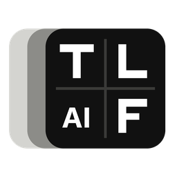

# TomasekLibreAIFrames

[](https://claude.ai)

AI video **frame interpolation** (RIFE 4.x) and **upscaling** (AnimeJaNai, Ani4K, Real-CUGAN, RealPLKSR, Nomos2, ...) for **Windows, Linux and macOS**, with a simple desktop UI.

- Any frame rate (x2, x3 ... or a target like 60 / 120 / 240 fps, no upper limit) and any output size - large frames are processed in tiles.
- Scene cuts are detected, so no smeared frames between two shots.
- Runs on the GPU through ONNX Runtime: **DirectML** (Windows, any GPU), **CoreML** (Apple Silicon), **WebGPU / CUDA / ROCm** (Linux). Falls back to the CPU if the GPU fails.
- Encodes with the GPU (NVENC, AMF, Quick Sync, VA-API, VideoToolbox) or the CPU (x264, x265, SVT-AV1 - AVX-512 aware), plus lossless FFV1 and ProRes. If an encoder cannot handle a video, the next one is used automatically.
- Model ranking by quality, measured speed and memory on your machine (Benchmark), memory estimate before each job, live RAM/VRAM usage.
- Before/after preview with zoom.
- **One-click setup**: downloads FFmpeg (if missing) and the recommended models from their original authors, checked by SHA-256.
- Duplicate (held) anime frames are skipped so motion stays even; scene cuts never get blended.
- English and Czech UI, light and dark theme, automatic updates from GitHub Releases (checksum-verified),
  Start menu / right-click "Process with" entries, single window (new files go to the open window), tray while processing.

How it works and why it is built this way: [docs/ARCHITECTURE.md](docs/ARCHITECTURE.md).

## Install

One command, no administrator rights; it downloads the newest release, checks its SHA-256 and installs it for your user:

| System | Command |
|---|---|
| Windows (PowerShell) | `irm https://raw.githubusercontent.com/TomasekValla/TomasekLibreAIFrames/main/install/windows.ps1 \| iex` |
| Linux | `curl -fsSL https://raw.githubusercontent.com/TomasekValla/TomasekLibreAIFrames/main/install/linux.sh \| sh` |
| macOS (Apple Silicon) | `curl -fsSL https://raw.githubusercontent.com/TomasekValla/TomasekLibreAIFrames/main/install/macos.sh \| sh` |

Linux takes the WebGPU build (any GPU through Vulkan); set `TLAF_VARIANT=cuda`, `rocm` or `cpu` before `sh` for another one. `TLAF_PRERELEASE=1` installs the newest pre-release.

## Download

Or get a build from [Releases](../../releases):

| System | File |
|---|---|
| Windows 10/11 x64 | `windows-x64.zip` |
| macOS 13.4+ on Apple Silicon (M1 or newer) | `macos-apple-silicon.zip` |
| Linux x64, any GPU (Vulkan) | `linux-x64-webgpu.tar.gz` |
| Linux x64, NVIDIA (needs CUDA 13 + cuDNN) | `linux-x64-cuda.tar.gz` |
| Linux x64, AMD (needs ROCm) | `linux-x64-rocm.tar.gz` |
| Linux x64, CPU only | `linux-x64-cpu.tar.gz` |

Start the app and press **One-click setup**. That's it.

Linux builds need glibc 2.38 or newer (Ubuntu 24.04, Fedora 39, Debian 13 or newer).

macOS: the app is not signed. If macOS refuses to open it, run `xattr -dr com.apple.quarantine TomasekLibreAIFrames.app` once.

## Build from source

```
cargo build --release                      # Windows (DirectML) / macOS (CoreML + WebGPU)
cargo build --release --features webgpu    # Linux, any GPU
cargo build --release --features cuda      # Linux, NVIDIA
cargo build --release --features migraphx  # Linux, AMD ROCm
```

The ONNX Runtime library for the chosen backend is downloaded and linked at build time.

## Models and licenses

Models are **not** part of this repository or the app. The app downloads them from their authors' releases on request, and shows each model's license and source. Some models are licensed for non-commercial use only - check the source page before using results commercially.

## License

GPL-3.0-or-later. Third-party components: see [THIRD_PARTY_NOTICES.md](THIRD_PARTY_NOTICES.md).
